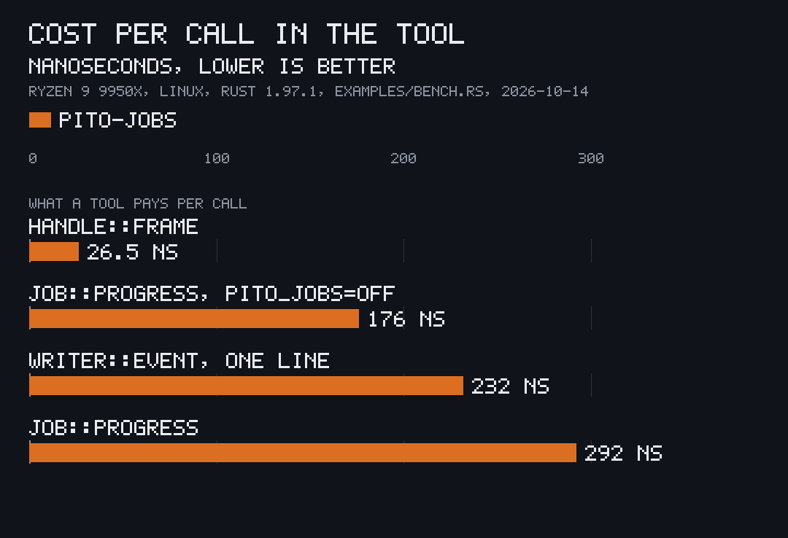

<p align="center"></p>

# pito-jobs

[](https://github.com/gmrdad82/pito-jobs/actions/workflows/ci.yml) [](https://github.com/gmrdad82/pito-jobs/tags)

pito-jobs is a small Rust crate that lets a command-line tool or an app say
what it is doing, so another program can show it live: a render's stage and
frame count, an encode's rate, an app's frame times. It is part of
[PITO MD](https://pitomd.com), where every tool writes through it and a
monitor reads it back.

- **26.5 ns** to record a frame in an app's heartbeat: no lock, no
  allocation, 0.00016% of a 16.7 ms frame at 60 fps.
- **292 ns** a `progress` call, safe to make every frame or every item: the
  file is rewritten at most once a second, atomically, and stays under 4 KiB
  (a typical record is 454 bytes).
- **Never in the way:** a write error never fails, blocks or slows the tool.
  A job starts no thread; a heartbeat keeps one low-priority thread.
- **Small:** 1,732 lines of Rust, three dependencies (`serde`, `serde_json`
  and, on unix, `libc`), and the crate itself compiles in 1.1 s.

The numbers are measured in [Speed and size](#speed-and-size), with how.

## Install and first use

The same line on Linux, macOS and WSL:

```sh
cargo add pito-jobs --git https://github.com/gmrdad82/pito-jobs --tag v1.0.2
```

or in your `Cargo.toml`:

```toml
pito-jobs = { git = "https://github.com/gmrdad82/pito-jobs", tag = "v1.0.2" }
```

It needs Rust 1.91 or newer. Works on Linux and macOS (Windows through WSL),
CI-tested on both. It also builds for native Windows and for `wasm32`, where
every handle is inert, so a cross-platform app can link it unconditionally.

Then, in the tool:

```rust
let job = pito_jobs::start("encode", None, "talk.mp4 → web.mp4");
job.stage("encode", Some(240), "frames");
for frame in 1..=240 {
    job.progress(frame);
}
job.finish(0);
```

While it runs, `$XDG_RUNTIME_DIR/pito-jobs/` on Linux, `$TMPDIR/pito-jobs/`
on macOS, or wherever `PITO_JOBS_DIR` points, holds one JSON file for it,
and any program can read it back with `pito_jobs::read_dir`. To watch three
jobs write while a reader draws them, as in the GIF above:

```sh
git clone https://github.com/gmrdad82/pito-jobs && cd pito-jobs
cargo run --release --example demo
```

## What it does

It has three forms, all JSON, all best-effort, and all specified in
[docs/formats.md](docs/formats.md):

- **A job record:** one file per running job, with its stage, progress, rate,
  device, output and how it ended.
- **An app heartbeat:** one file per running app with its fps, frame times
  (p50, p95, p99, max), GPU time and missed frames.
- **Progress lines:** the `--progress json` lines an op prints on stdout, one
  object per line, with a writer and a tolerant reader.

The files live in RAM where the OS offers it (`$XDG_RUNTIME_DIR` is cleared
at logout), and nothing is kept as history: a reader that wants history
keeps its own.

### Job records

The GIF at the top is `examples/demo.rs`: three jobs write their records and a
reader draws them once a second.

```rust
let job = pito_jobs::start("render", None, "trailer-01")
    .detail("1080p → 720p web")
    .device("GPU");
job.stages(&["build", "trace", "encode"]);
job.stage("build", None, "steps");
job.stage("trace", Some(600), "frames");
for frame in 1..=600 {
    job.progress(frame);
}
job.finish(0);
```

`progress` updates the rate on every call and writes the file at most once a
second. `stage`, `stages`, `stage_note`, `rate`, `finish` and `fail` write at
once. `stages` declares the stage names in order, so a reader can draw a
stage bar without knowing the tool; call it as soon as the plan is known,
even after the first stage started.

`process::exit` runs no destructors, so call `finish(code)` or
`fail(code, error)` on every exit path. Drop is a last resort: a job dropped
unfinished is written as `failed` with exit code 1.

`child_env` returns the variables a child process needs to link its own job
as a child of this one. The crate never changes the current process's
environment:

```rust
for (key, value) in job.child_env() {
    command.env(key, value);
}
```

When a record would pass 4 KiB, `stages` is dropped first, then the longest
texts are cut on a character boundary.

Reading the jobs back:

```rust
let dir = std::env::var("PITO_JOBS_DIR").unwrap_or_else(|_| "/run/user/1000/pito-jobs".into());
for record in pito_jobs::read_dir(dir) {
    let percent = record.progress.as_ref().and_then(|p| p.fraction()).map(|f| f * 100.0);
    println!("{} {} {:?} {:?}", record.tool, record.label, record.stage, percent);
}
```

`read_dir` skips a file that does not parse, and unknown fields are ignored,
so an old reader reads a newer file.

### App heartbeats

<p align="center"></p>

`examples/heartbeat.rs`: a desktop viewer and a terminal app publish their
heartbeats and a reader draws them. The viewer's p99 and max show the one
frame in 97 that runs past its 16.7 ms budget.

```rust
let live = pito_jobs::live(
    "notes",
    env!("CARGO_PKG_VERSION"),
    pito_jobs::Surface::Tui,
    pito_jobs::Pacing::OnChange,
);
live.frame(frame_time);
live.frame_with(cpu_time, Some(gpu_time));
live.detail("converging 128/512 spp");
```

`frame` stores a sample in a fixed ring of 2,048 slots (80 KiB, allocated
once): it never allocates or locks. One low-priority thread rewrites the
file once a second and removes it when the handle is dropped. The heartbeat
is opt-in: it publishes only when `PITO_JOBS_DIR` is set or the folder
`pito/apps/` exists in the user's data folder (`$XDG_DATA_HOME`, else
`~/.local/share` on Linux and `~/Library/Application Support` on macOS).
Anywhere else `live` returns an inert handle with no thread and no file, so
an app you ship writes nothing on its users' machines. `apps_dir` and
`read_apps` read the heartbeats back.

### Progress lines

<p align="center"></p>

`examples/lines.rs`: an install op prints its progress lines on stdout and
the reader draws each one, with the raw JSON line beneath.

```rust
use pito_jobs::op::{self, Line, State, Writer};

let mut out = Writer::new(std::io::stdout(), "install", "notes");
out.event("build", State::Progress, Some(0.42), Some("Compiling 34/80"))?;
out.end(true, "notes 0.18.9 installed")?;

for line in op::read(child_stdout) {
    match line {
        Line::Event(event) => draw(&event.app, &event.stage, event.fraction),
        Line::End(end) => finish(&end.app, end.ok, &end.msg),
        Line::Summary(summary) => report(&summary.results),
    }
}
```

`Writer` stamps the version, op, app and time on every line, writes each line
whole and flushes it, and writes nothing after the end line. `op::read`
skips lines that are not JSON or not version 1, such as a tool's human
output, and clamps a fraction to 0 to 1.

## Speed and size



`cargo run --release --example bench` measures what a tool and a reader pay
per call. One run on 2026-10-14, AMD Ryzen 9 9950X, Linux, Rust 1.97.1, on a
busy machine (load average about 70), the files in RAM:

| Call | Cost | How |
| --- | --- | --- |
| `Handle::frame` | 26.5 ns | 5,000,000 frames into a live heartbeat |
| `Job::progress` | 292.2 ns | 5,000,000 calls on a live job, its file rewritten once a second |
| `Job::progress`, `PITO_JOBS=off` | 176.0 ns | the same with every write off |
| `Writer::event` | 231.7 ns | 1,000,000 progress lines into `io::sink` |
| `Line::parse` | 670.7 ns | 1,000,000 parses of one progress line |
| `read_dir` | 4.2 µs a record | 2,000 reads of a folder of 32 job records |
| A job record on disk | 454 bytes | the benchmark's own record |

Size, at this commit: 1,732 non-blank lines of library code (tests aside),
three direct dependencies and 12 crates beneath it in all, serde's derive
macros counted, a cold
release build of the crate and its dependencies in 25.3 s on the same busy
machine, and 1.1 s for the crate alone once its dependencies are built.

## Environment

| Variable | Effect |
| --- | --- |
| `PITO_JOBS_DIR` | Folder for the files. When unset, `$XDG_RUNTIME_DIR/pito-jobs`, or `$TMPDIR/pito-jobs` on macOS. |
| `PITO_JOBS=off` | Every write is a no-op, such as in a tool's own tests. |
| `PITO_JOB_ID` | Id of the job that started this one, stored as `parent`. |
| `PITO_INVOKER` | Who started the tool, stored as `invoker` and passed on to children. |
| `GPU_QUEUE_PID` | Pid of a surrounding GPU queue run, stored as `pgpu.pid` until the tool sets or clears it. |
| `RIDE_APP`, `RIDE_SET` | Set by a test or fixture runner; a heartbeat records them as `ride` and `ride_set`. |

## Part of PITO MD

pito-jobs is one of the building blocks of [PITO MD](https://pitomd.com).
The renderer [pfx](https://github.com/gmrdad82/pfx), the scene builder
[Manfred](https://github.com/gmrdad82/manfred), the terminal recorder
[prec](https://github.com/gmrdad82/prec) and the converter
[pconv](https://github.com/gmrdad82/pconv) write their jobs through it, and a
job run under [pgpu](https://github.com/gmrdad82/pgpu) records the queue's
pid. The chart above is drawn by
[pito-compare](https://github.com/gmrdad82/pito-compare) and the GIFs are
recorded by prec and made by pconv.

## Build and test

```sh
bin/gate --fast   # rustfmt, clippy with -D warnings, the tests, a wasm32-wasip2 check
bin/gate          # adds the doc tests, Windows and macOS checks, the examples' release build and the docs bundle
bin/docs-bundle   # the docs pages, the API reference and the changelog in tmp/docs-vX.Y.Z.tar.gz
```

The tests use [cargo-nextest](https://nexte.st). The gate needs the
`wasm32-wasip2`, `x86_64-pc-windows-gnu` and `aarch64-apple-darwin` targets
(`rustup target add …`). CI runs `bin/gate` on Linux and macOS.

## Contributing

Issues and pull requests are welcome. The files and lines are a contract that
other programs read, so every change is additive: a new field is optional, an
old reader still reads a new file and a new reader an old one, `v` stays 1,
and a file stays under 4 KiB. A change to a format updates
[docs/formats.md](docs/formats.md) and this README in the same pull request.
`bin/gate` must pass. Please follow the [code of conduct](CODE_OF_CONDUCT.md),
and report security issues privately as [SECURITY.md](SECURITY.md) says.

## Licence


MIT, © Catalin Ilinca: see [LICENSE](LICENSE). The licence covers the code
only: the PITO and PITO MD names, every app and game name and their logos
are © Catalin Ilinca, all rights reserved ([TRADEMARKS.md](TRADEMARKS.md)).
